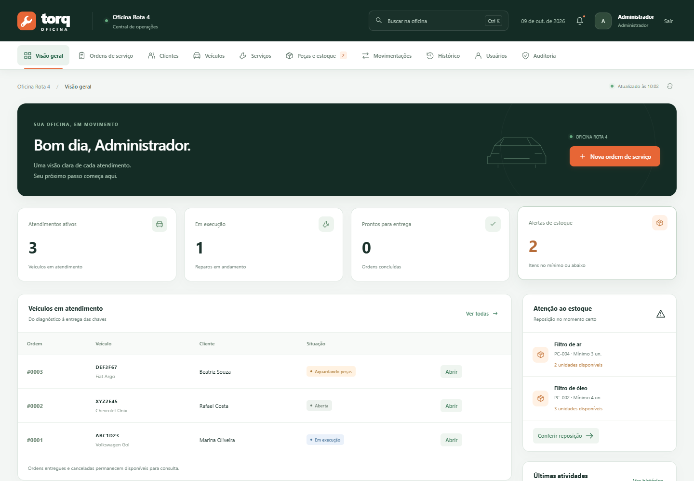

# Torq Oficina — Grupo 04

Sistema de gestão da **Oficina Rota 4**, desenvolvido em **Java + MySQL** para o trabalho de Testes de Sistemas.

Clientes, veículos, ordens de serviço, serviços, peças, estoque, histórico e auditoria. Interface com navegação superior, busca global, filtros, paginação e exportação CSV.

## Executar no IntelliJ IDEA

Pré-requisitos: **JDK 17 ou superior**, **MySQL 8 iniciado** e navegador.

1. Clone este repositório ou baixe e extraia o ZIP do GitHub.
2. No IntelliJ, abra **`TorqOficina/pom.xml`** como projeto Maven. Aguarde as dependências e selecione um JDK 17 ou superior no SDK do projeto e no JRE do Maven, se for usá-lo para compilar.
3. Copie `TorqOficina/config.properties` para `TorqOficina/config.local.properties` e ajuste host, porta, banco, usuário e senha do seu MySQL. A configuração local tem prioridade e fica fora dos commits.
4. Execute **Torq Oficina - Preparar banco** na lista de configurações do IntelliJ. Ela cria o banco, as tabelas e os dados fictícios, preservando dados já existentes.
5. Execute **Torq Oficina - Iniciar**. Essa configuração mantém o servidor ativo.
6. Abra **http://localhost:8080** ou a porta configurada em `server.port`. O endereço aparece no console.

As configurações `.run` estão incluídas para abrir tanto a raiz do repositório quanto a pasta `TorqOficina`. Se abrir a raiz, importe também o `TorqOficina/pom.xml` pelo Maven.

**Acesso de demonstração:** `admin@torq.local` / `Oficina@123`.

## Executar pelos arquivos .bat no Windows

Entre na pasta `TorqOficina`, ajuste a conexão com o MySQL, execute **`preparar_banco.bat`** e depois **`iniciar.bat`**. O driver JDBC está incluído em `TorqOficina/lib`; não é necessário instalar Maven para usar os arquivos `.bat`.

## Material incluído

| Caminho | Conteúdo |
| --- | --- |
| [TorqOficina/README.md](TorqOficina/README.md) | Manual completo, perfis, testes e solução de erros |
| `TorqOficina/src` e `TorqOficina/web` | Código Java e interface |
| `TorqOficina/banco` | Scripts de criação, estrutura e dados fictícios |
| `TorqOficina/testes` | Testes automatizados e resultados registrados |
| `TorqOficina/documentacao` | Requisitos, modelagem, plano de testes e roteiro |
| `TorqOficina/entrega` | Documentação PDF, apresentação PPTX e PDF |
| [ZIP atualizado para entrega](Entrega_Grupo04_Oficina_Mecanica_Atualizada.zip) | Pacote completo para extração e execução |

O JDK e o servidor MySQL devem estar instalados no computador de execução. O repositório não inclui o banco local desta máquina nem credenciais particulares.

## Validação registrada

44 cenários da API e 26 cenários da interface aprovados, além das verificações de integridade e inicialização. Execução validada no MariaDB 10.4.32 do XAMPP, com JDK 23 e alvo Java 17. A compilação Maven passou. A validação em um servidor MySQL 8 dedicado permanece pendente.

## Integrantes

- Fernando Ian Harmel
- Arthur Ayyub Rodrigues
- Victor Nestor Prim
- Arthur Krebs Delvons
- Larissa Beatriz Luz

Material preparado com assistência de IA. O enunciado contém uma restrição ao uso de IA na avaliação; consulte a regra da disciplina antes de entregar. A divisão de falas no roteiro é uma sugestão.
