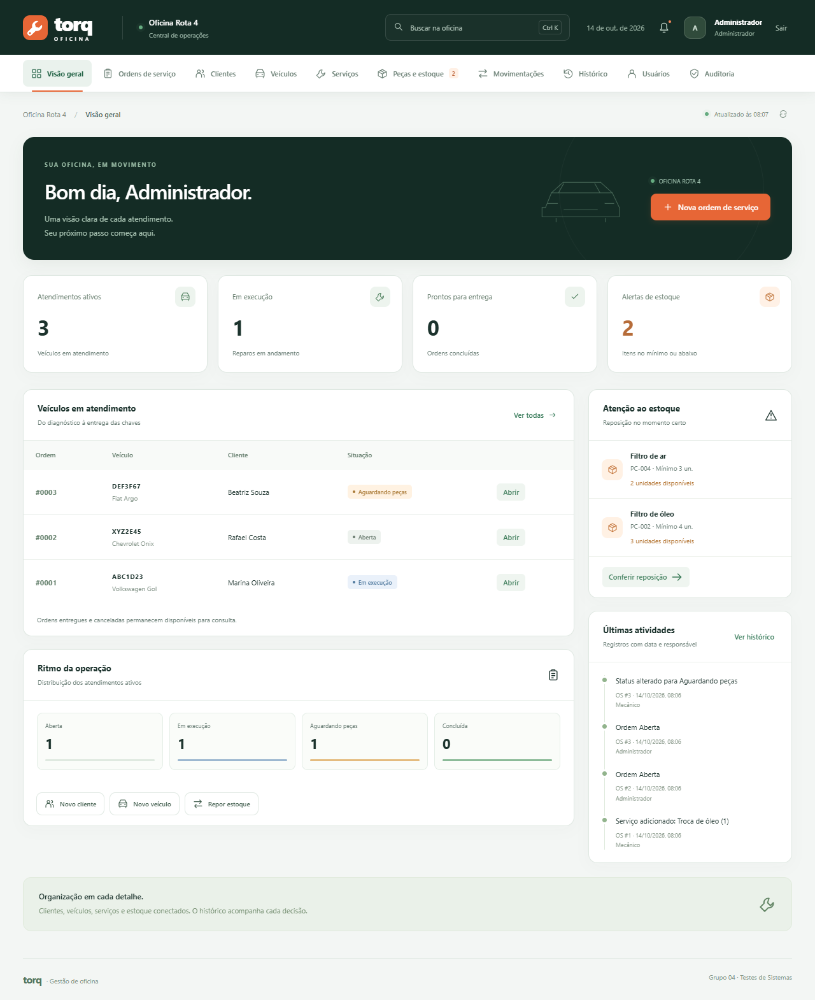

# Torq Oficina — Grupo 04

Sistema de gestão da **Oficina Rota 4**, com **Java, JDBC, banco MySQL/MariaDB pelo XAMPP e interface web**. Inclui clientes, veículos, ordens, serviços, peças, estoque, histórico e auditoria.

## Executar no Windows com XAMPP

1. Baixe o [pacote pronto para rodar](TorqOficina_Grupo04_Pronto_Para_Rodar.zip) e extraia tudo. Também pode clonar este repositório ou usar **Code → Download ZIP**.
2. Tenha **Java 17 ou superior** e **XAMPP** instalados.
3. No **XAMPP Control Panel**, clique em **Start** na linha **MySQL**.
4. Confira `TorqOficina/config.properties`: a configuração fornecida usa `127.0.0.1`, porta `3306`, banco `torq_oficina`, usuário `root` e senha vazia. Ajuste se a instalação do seu banco for diferente.
5. Dê dois cliques em **`INICIAR_SISTEMA.bat`** na raiz. O Java prepara as 11 tabelas e os dados iniciais e abre o navegador em **http://localhost:8080**.
6. Entre com **admin@torq.local** e senha **Oficina@123**.

Mantenha a janela do Java e o banco do XAMPP em execução. Para encerrar, use **Ctrl+C** no Java antes de parar o banco. O programa já vem compilado em `TorqOficina/dist/TorqOficina.jar`; Maven, Node e Python são opcionais e não são necessários para executar.

Para mostrar as tabelas ao professor, inicie também **Apache** no XAMPP e abra **http://localhost/phpmyadmin** (ajuste o endereço se Apache usar outra porta). O sistema Java atende em sua própria porta.

O [guia TXT passo a passo](COMO_RODAR_E_APRESENTAR_O_SISTEMA.txt) explica a configuração, o roteiro de apresentação, os erros comuns e como **exportar/importar o banco pelo phpMyAdmin para outro computador**. O ZIP do projeto não inclui dados pessoais ou uma cópia do banco do XAMPP.

## Classes Java organizadas

Os **29 arquivos Java** ficam em `TorqOficina/src/main/java/oficina`, na estrutura padrão do Maven:

| Pacote | Responsabilidade |
| --- | --- |
| `model` | Cliente, veículo, serviço, peça, ordem, usuário, perfis e estados. |
| `dao` | SQL parametrizado, consultas, histórico, auditoria e movimentações. |
| `service` | Regras dos cadastros, das ordens e do estoque. |
| `database` | Conexões, preparação das tabelas e dados de demonstração. |
| `security` | Hashes PBKDF2, sessões e tokens CSRF. |
| `web` | API HTTP, transações, respostas e entrega da interface. |
| `config`, `validation`, `exception`, `util` | Configuração, validações, erros e JSON. |

A classe principal é **`oficina.App`**. Consulte o [guia das classes](TorqOficina/documentacao/arquitetura_java.md) para ver a árvore e um exemplo do fluxo da tela até o banco.

## Executar no IntelliJ IDEA

1. Abra `TorqOficina/pom.xml` como projeto Maven e escolha um JDK 17 ou superior.
2. Inicie MySQL no XAMPP e ajuste a conexão. Se preferir, copie `config.properties` para `config.local.properties`; a configuração local tem prioridade e não entra nos commits.
3. Execute **Torq Oficina - Preparar banco** e depois **Torq Oficina - Iniciar** nas configurações incluídas em `.run`.
4. Mantenha o diretório de trabalho em `TorqOficina`. O código também localiza essa pasta quando executado pela raiz do repositório; `torq.root` e `torq.config` permitem indicar caminhos explicitamente.

As configurações `.run` atendem tanto à abertura da raiz quanto da pasta `TorqOficina`. A opção de pasta temporária nelas é voltada ao Windows. Os arquivos `.bat` detectam o Java e tratam essa configuração automaticamente.

Para recompilar sem Maven, feche o servidor e execute `TorqOficina/compilar.bat`. `TorqOficina/empacotar.bat` gera novamente o ZIP compartilhável.

## Alternativa com banco local

`TorqOficina/iniciar_demo.bat` inicia uma demonstração com H2, sem XAMPP. Esse banco é criado em `TorqOficina/dados/torq_demo.mv.db` e preserva seus próprios registros. **Ele usa uma base separada do banco do XAMPP.** Para a apresentação com XAMPP, use o iniciador principal.

## Material e validação

| Caminho | Conteúdo |
| --- | --- |
| [Guia TXT](COMO_RODAR_E_APRESENTAR_O_SISTEMA.txt) | Execução em outro PC, XAMPP, phpMyAdmin e roteiro de apresentação. |
| [Manual completo](TorqOficina/README.md) | Perfis, modos de execução, testes e solução de erros. |
| [Guia das classes](TorqOficina/documentacao/arquitetura_java.md) | Organização e responsabilidades do Java. |
| `TorqOficina/banco` | Estrutura SQL, relacionamentos e dados fictícios. |
| `TorqOficina/testes` | Testes automatizados, relatórios e capturas. |
| `TorqOficina/documentacao` | Requisitos, modelagem e roteiro. |
| `TorqOficina/entrega` | PDFs e apresentação PPTX preservados. |
| [ZIP pronto](TorqOficina_Grupo04_Pronto_Para_Rodar.zip) | Programa compilado, drivers, fontes e documentos. |

A versão organizada passou em **44 cenários de API**, **26 cenários no navegador**, **5 verificações do banco** e verificações de inicialização e persistência, usando JDK 21.0.11, H2 2.5.252 e Edge. Os relatórios com sufixo `_organizado` registram essa execução. Os relatórios anteriores registram testes em MariaDB 10.4.32 do XAMPP, com JDK 23 e alvo Java 17. A instalação do XAMPP do computador de apresentação deve ser conferida antes do uso; MySQL 8 dedicado ainda não foi validado. Veja o [relatório de validação](TorqOficina/documentacao/validacao_organizacao.md).

## Integrantes

- Fernando Ian Harmel
- Arthur Ayyub Rodrigues
- Victor Nestor Prim
- Arthur Krebs Delvons
- Larissa Beatriz Luz

Material preparado com assistência de IA. O enunciado contém uma restrição ao uso de IA na avaliação; consulte a regra da disciplina antes de entregar. A divisão de falas no roteiro é uma sugestão.
